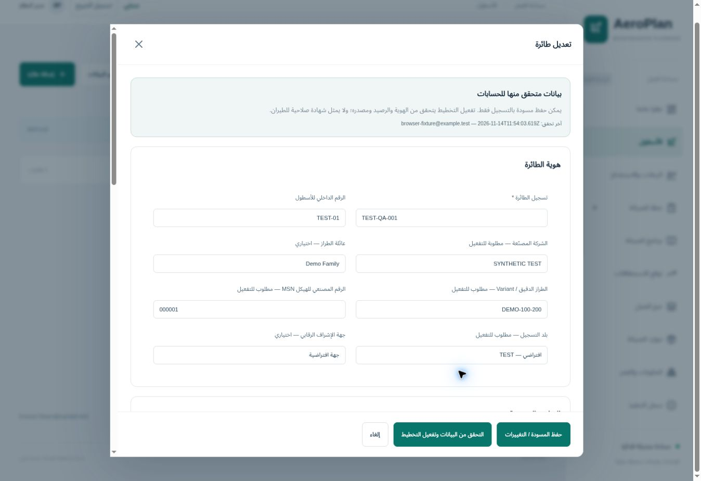

# AeroPlan 0.10.0 — بطاقة الطائرة والتحقق من البيانات

> تحديث 0.14.0: أصبحت القوائم الخمس، بما فيها العائلة والجهة، مطلوبة للتفعيل الجديد وتُدار من الإعدادات. تُحفظ البطاقات السابقة دون تغيير تلقائي. راجع [دليل القوائم الحالي](SETTINGS_UPDATE_0_14_AR.md) قبل تطبيق التفاصيل التاريخية أدناه.

تحديث تراكمي لنسخة Docker المحلية. أُضيفت بيانات بطاقة الطائرة وضوابط جاهزيتها للحسابات، مع الاحتفاظ بسجلات النظام ومعرّفاتها. تبقى حسابات APU المستقلة ووحدات البيانات المتخصصة للتطوير اللاحق.

## الحقول والسلوك

| القسم | الحقول | متى تلزم؟ |
| --- | --- | --- |
| تعريف السجل | تسجيل الطائرة | مطلوب لحفظ المسودة؛ لا يتغير معرّف السجل الداخلي عند تعديله |
| الهوية الفنية | الشركة المصنّعة، عائلة الطراز، الطراز الدقيق / Variant، MSN، بلد التسجيل، جهة الإشراف، رقم الأسطول الداخلي | المصنع والطراز الدقيق وMSN وبلد التسجيل مطلوبة للتفعيل؛ بقية الحقول اختيارية |
| العدادات | ساعات الهيكل FH العشرية، دورات الهيكل FC الصحيحة، تاريخ ووقت مرجع الرصيد UTC، مصدر الرصيد، إصدار مستند منشور اختياري | الرصيد ومصدره وتاريخه والتأكيد الصريح مطلوبة للتفعيل؛ الرصيد غير المعروف يُحفظ فارغًا ولا يتحول إلى صفر |
| التواريخ | التصنيع، التسليم الأول، الانضمام للمشغّل | اختيارية؛ تُرفض التواريخ غير الصحيحة أو المستقبلية وتسليم/خدمة يسبقان التصنيع |
| المرجع الآلي | تاريخ بدء الخدمة، FH وFC عند بدء الخدمة | اختيارية للتخطيط اليدوي؛ تلزم معًا للتهيئة الآلية، ولا تتجاوز العدادات الحالية |
| الإدارة | المشغّل، المالك، قاعدة الصيانة، حالة الأسطول، الملاحظات | حالة الأسطول مطلوبة للتفعيل؛ البقية اختيارية |

الساعات عشرية: `1.5` تعني ساعة و30 دقيقة. جميع قيم UTC تمثل الوقت العالمي، وليس توقيت الجهاز المحلي. إدخال صفر صحيح ومؤكد مختلف عن ترك الرصيد مجهولًا.

حالة الأسطول تصف الإدارة: ضمن الأسطول، تحت الصيانة، مخزنة، خارج الأسطول. لا تعني شهادة صلاحية للطيران. الطائرة المخزنة أو تحت الصيانة تبقى قابلة للتخطيط، بما فيه الاستحقاق التقويمي؛ حالة «خارج الأسطول» توقف التخطيط الجديد.

## المسودة والتحقق والسجلات السابقة

1. احفظ مسودة بالتسجيل فقط عند نقص المعلومات.
2. أكمل الهوية والرصيد ووقت مرجعه ومصدره وحالة الأسطول.
3. إن رغبت في دليل إلكتروني، احفظ المسودة أولًا، ثم ارفع مستندًا مرتبطًا بالطائرة في مكتبة الوثائق وأكمل نشره؛ اختر إصداره من البطاقة.
4. راجع السجلات الفعلية ثم ضع علامة التأكيد واضغط «التحقق من البيانات وتفعيل التخطيط».

يسجل الخادم المستخدم والوقت ولقطة مرجع الرصيد؛ لا يقبل تمرير حالة تحقق مصطنعة من المتصفح أو ملف الاستيراد. التفعيل متاح لصاحب صلاحية تعديل الطائرات، وهو تحقق بيانات للحسابات ولا يحل محل إجراءات الاعتماد الفني المعتمدة لدى الجهة المشغّلة.

تبقى الطائرات القديمة محفوظة دون تحويل أرقامها أو حذف مهامها، وتظهر كبيانات تحتاج الاستكمال والتحقق. افتح كل بطاقة وأكملها. تُحجب حسابات الاستحقاق والتوقعات وحساب عمر المكوّن المركب وترحيل الرحلات والتخطيط الجديد المرتبط بالطائرة حتى التحقق منها. لا تُعرض البطاقة غير المكتملة كأنها ضمن الحدود، وتُترك الأرصدة المتبقية في التقارير فارغة مع سبب الحجب. تظل إجراءات الإرجاع للمسودة وإلغاء الحزمة متاحة للحالات التي تسمح بها الإجراءات الحالية.

عند تغيير هوية أو رصيد أو مرجع أساسي سبق التحقق منه، يلزم سبب واضح؛ تعود البطاقة إلى المسودة حتى إعادة التحقق. تُسجل فروق القيم في سجل التغييرات. تحديث المالك أو المشغّل أو الملاحظات وحده لا يلغي التحقق.

التسجيل فريد دون حساسية لحالة الأحرف. تُمنع هوية مصنع + طراز دقيق + MSN مكررة داخل مساحة العمل. يُحفظ MSN كنص، بما فيه الأصفار الأولى. تغيير الهوية يستلزم إعادة تقييم انطباق المتطلبات الفنية؛ تبقى القرارات والتنفيذات السابقة محفوظة كأدلة تاريخية.

## مرجع العدادات بعد بدء الاستخدام

بعد تسجيل استخدام أو تهيئة مهمة آلية أو اعتماد تركيب مكوّن، لا تُعدّل العدادات الحالية مباشرة من البطاقة. تُحدَّث من الرحلات أو التصحيحات المعتمدة. يبقى مرجع الرصيد المتحقق منه ولقطته محفوظين، وتظهر العدادات الحالية بصورة منفصلة. أول ترحيل رحلة يستخدم وقت مرجع الرصيد نفسه لمنع افتتاح دفتر بتاريخ مختلف.

يبقى مصدر الرصيد الافتتاحي وإصدار دليله محميين بعد بدء الاستخدام؛ يُوثّق أي تصحيح لاحق كإجراء جديد له سبب ومرجع، دون استبدال المرجع التاريخي. يبقى مرجع بدء الخدمة محميًا إذا استُخدم في حساب آلي محفوظ. يمكن استكمال بيانات المرجع المفقودة في سجل قديم قبل أول تحقق، مع الاحتفاظ بدفتر الاستخدام الموجود.

## الاستيراد والمرونة والنسخ الاحتياطي

- يتضمن قالب الاستيراد الحقول الجديدة. تُستورد الطائرات كمسودات دائمًا، حتى عند وجود قيم تحقق في الملف. دليل المستند يُربط بعد إنشاء السجل، وليس بمعرّف وارد من Excel.
- تدعم حقول التاريخ التقويمي تواريخ Excel التسلسلية. أدخل مرجع العدادات كنص UTC ISO مثل `2026-11-01T10:00:00.000Z`.
- يُعاد التحقق من بيانات دفعة الاستيراد وقت التطبيق؛ تُرفض المهام التي تشير إلى طائرة لم يكتمل تحققها.
- تظهر الحقول الجديدة في إعدادات ترتيب النماذج والتقارير والتنبيهات. يُطبق ترتيب الحقول داخل أقسام البطاقة. يمكن حفظ المسودة دون إكمال الحقول المخصصة المطلوبة، وتُفرض عند التفعيل أو حفظ بطاقة متحقق منها.
- النسخ الجديدة تحمل مخطط `aeroplan-business-v9`. يقبل الإصدار الحالي نسخ v8 وv6 السابقة، مع بقاء البطاقات القديمة غير متحقق منها. لا تحاول استعادة نسخة v9 ببرنامج أقدم.
- لم تُضف جداول أو ترحيلات قاعدة بيانات؛ تبقى 18 مجموعة بيانات أعمال و9 ترحيلات SQL. تشمل النسخ بيانات البطاقة وسجل التغييرات وإصدارات المستندات وملفاتها.

## تطبيق التحديث على Windows

أنشئ نسخة احتياطية من شاشة النسخ والاستعادة واحفظها خارج الحاوية. افتح PowerShell في مجلد المشروع الحالي الذي يحتوي `compose.yaml`، مثل المسار الذي تستخدمه:

`C:\Users\Administrator\Downloads\AeroPlan-Docker-0.9\AeroPlan-Docker`

نزّل `AeroPlan-Docker-Aircraft-Update-0.10.0.zip` إلى Downloads. نفّذ كل أمر أدناه وحده وبالترتيب.

```powershell
Expand-Archive -LiteralPath "$env:USERPROFILE\Downloads\AeroPlan-Docker-Aircraft-Update-0.10.0.zip" -DestinationPath . -Force
```

```powershell
docker compose up -d --build --force-recreate --wait
```

```powershell
(Invoke-RestMethod -Uri "http://localhost:8080/healthz").version
```

يجب أن تظهر `0.10.0`. أعد تحميل المتصفح باستخدام `Ctrl+F5` ثم افتح الأسطول. لا تحتاج إعادة تهيئة المدير. حزمة التحديث لا تحتوي `compose.yaml` أو `.env` أو بيانات التشغيل؛ لا تستخدم `docker compose down -v` لأن ذلك يحذف وحدات التخزين.

## التحقق المنفذ

اختبارات آلية ببيانات اصطناعية على SQLite المحلي وD1، واختبار HTTP لنسخة Node الإنتاجية، وفحص TypeScript وبناء الإنتاج. شمل فحص المتصفح حفظ المسودة واستكمال الهوية والتواريخ والرصيد والتحقق وإعادة فتح البطاقة لإثبات حفظ القيم وMSN والأرصدة والتواريخ. تتضمن الاختبارات نشر دليل مصدر وتثبيت بصمته، ومنع التفعيل المزور، والرصيد المجهول، والتكرار، والحفظ المتزامن القديم، وحماية الدفتر، واستكمال سجل قديم، واستيراد المسودات والنسخ والاستعادة المعزولة.

لا تتوفر هنا خدمة Docker لتشغيل الصورة نفسها. يختبر مسار Node الإنتاجي التطبيق الذي تستخدمه الصورة؛ التحقق النهائي من Docker Desktop على جهازك هو تشغيل Compose وفحص إصدار `/healthz`. يلزم إجراء القبول التشغيلي على بياناتكم الفعلية بعد استكمال البطاقات.


